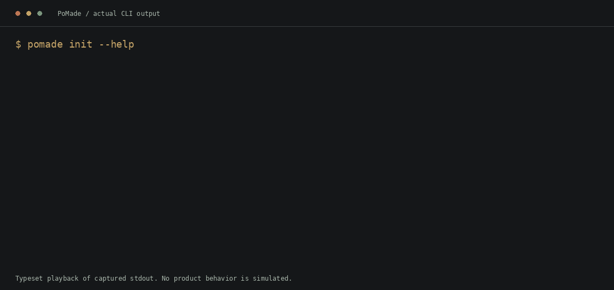
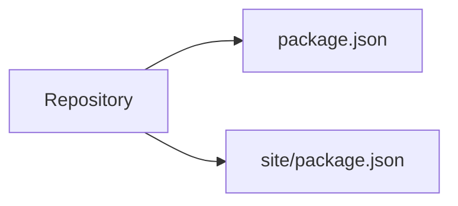

<!-- pomade:start header -->
<p align="center"></p>

<h1 align="center">PoMade</h1>

<p align="center"><em>Code pushed. First impression handled.</em></p>

 [](LICENSE) [](https://github.com/Gurtejhundal/PoMade/actions)

[Quickstart](#quickstart) · [Features](#features) · [Website](https://pomade-swart.vercel.app/) · [Repository](https://github.com/Gurtejhundal/PoMade)

<p align="center"></p>

[View the static cover](docs/media/pomade-static.svg)
<!-- pomade:end header -->

<!-- pomade:start overview -->
## Overview

Your agent writes the code. PoMade handles the README, media, About, and topics. Every push looks finished.
<!-- pomade:end overview -->

<!-- pomade:start preview -->
## See it in action

<p align="center"></p>

[View the static demo](docs/media/cli-demo-static.png)
<!-- pomade:end preview -->

<!-- pomade:start quickstart -->
## Quickstart

```bash
git clone https://github.com/Gurtejhundal/PoMade.git
cd PoMade
npm ci
npm run build
npm link
```
<!-- pomade:end quickstart -->

<!-- pomade:start features -->
## Features

- **Three README styles** — Simple for a clear first run, Signature for a distinct identity, and Motion for an animated cover and real demo media.
- **Polish after a push** — A GitHub Action maintains marked README sections and cover assets on pushes to main. Text outside managed sections stays yours.
- **The whole front door** — Configure a concise About, homepage, and curated topics. Sync metadata with an administration-scoped token while preserving existing topics.
- **A coding-agent companion** — A Codex and Claude Code plugin with bundled agent context hooks. Optional local Git pre-push checks preserve existing hooks.
- **Preview before writing** — Review a saved plan with target hashes, then apply that exact plan. Stale targets, escaping paths, and malformed markers are rejected.
<!-- pomade:end features -->

<!-- pomade:start usage -->
## Usage

```bash
# Run inside the repository you want to polish
pomade init --preset signature --approved
pomade diff
pomade apply --approved
```
<!-- pomade:end usage -->

<!-- pomade:start architecture -->
## Architecture


<!-- pomade:end architecture -->

<!-- pomade:start development -->
## Development

Configured test command (its presence does not imply tests pass):

```bash
npm test
```
<!-- pomade:end development -->

<!-- pomade:start license -->
## License

[MIT](LICENSE)
<!-- pomade:end license -->

## Choose your first impression

| Simple | Signature | Motion |
| --- | --- | --- |
| Quiet, direct, command-first. | A distinct identity and a real product image. | Animated cover, real demo, static alternatives. |
| [See the README](docs/templates/SIMPLE.md) | [See the README](docs/templates/SIGNATURE.md) | [See the README](docs/templates/MOTION.md) |

## The README Studio

A real capture of the local PoMade website. The Studio edits project facts, previews Markdown and diffs, and exports a repository kit with its media files.


[Open the website](https://pomade-swart.vercel.app) · [Mobile capture](docs/media/site-mobile.png) · [Design research](docs/design/REFERENCE_ANALYSIS.md)

## Keep it polished on pushes

`pomade init` installs `.pomade.json` and a GitHub Action that maintains generated sections on pushes to `main`. Review the first diff and adopt managed markers once. Add the repository secret **POMADE_TOKEN** with **Administration: write** to enable About/topics updates; generated file commits use the normal workflow token.

```bash
# Preview the maintenance run
pomade sync --approved --dry-run

# Review once, apply that exact plan
pomade plan --output /tmp/pomade-plan.json
pomade apply --plan /tmp/pomade-plan.json --approved
```

[Setup, permissions, and branch-protection details](docs/PUSH_WORKFLOW.md).

## Agent plugin

The portable skill lives in [`skills/pomade`](skills/pomade/SKILL.md). The Claude Code plugin can be loaded from a local checkout:

```bash
claude --plugin-dir /absolute/path/to/PoMade
```

The skill includes presentation when preparing a requested push. The GitHub Action handles maintenance after the push. Installing the skill alone does not create a Git hook.

## Development and status

Stable release: `1.0.1`. Install the packaged CLI from [GitHub Releases](https://github.com/Gurtejhundal/Pomade/releases/tag/v1.0.1). CLI, development, and hooks require Node.js 22 or newer. The website is a separate build target. npm registry publication is separate.

```bash
npm test
npm run typecheck
npm run build
npm run site:build
```

The terminal GIF is typeset playback of actual captured CLI stdout, not a screen recording. Owner-authored claims need review. Scanning a script does not establish that it passes.

[Audit and verification report](docs/audit/2026-11-18.md).

## Install the plugin

Codex:

```sh
codex plugin marketplace add Gurtejhundal/Pomade --ref v1.0.1
codex plugin add pomade@pomade
```

Restart or open a new chat, select PoMade, and review/trust its bundled hooks. The plugin is distributed through this repository marketplace, separately from the universal public directory.

Claude Code:

```text
/plugin install pomade --marketplace Gurtejhundal/Pomade
```

The CLI must be installed separately. Session and pre-tool hooks add presentation context. For an optional local push gate, run `pomade hooks install --approved` after configuring the repository. Run `pomade hooks uninstall --approved` to remove only PoMade's own hook. Existing hooks and custom hook managers are preserved.

[Full installation and hooks guide](https://pomade-swart.vercel.app/install) · [Functions](https://pomade-swart.vercel.app/features) · [Command reference](https://pomade-swart.vercel.app/docs)
