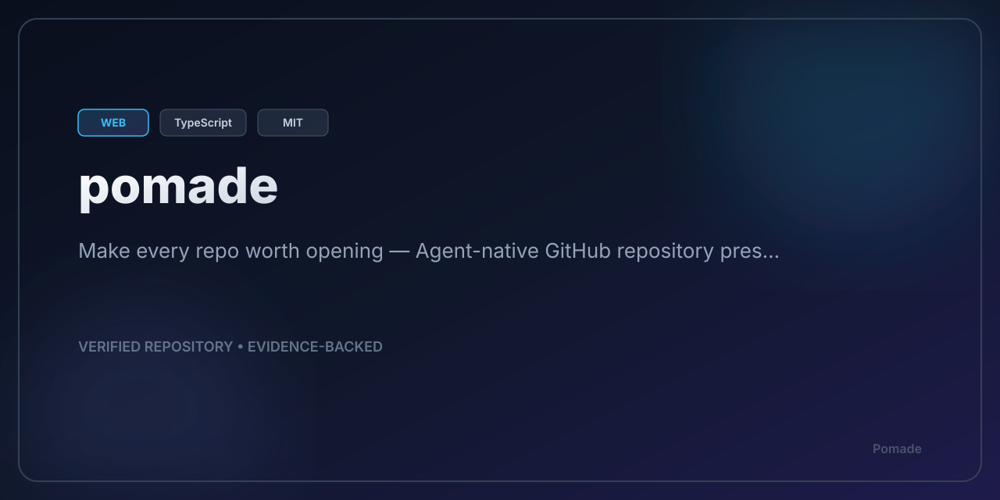
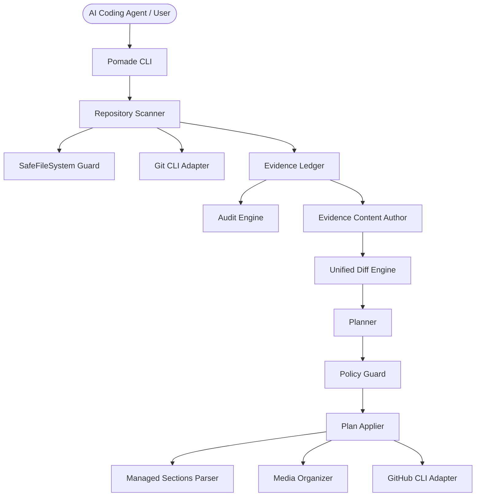
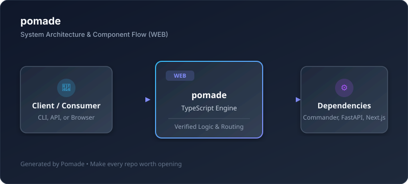

<!-- pomade:start header -->
# Pomade

> **Make every repo worth opening.**  
> Agent-native GitHub repository presentation, packaging, and maintenance layer.

<p align="center">
  
</p>

<p align="center">
  <a href="LICENSE"></a>
  
  =18.0.0" />
  
  <a href=".github/workflows/ci.yml"></a>
</p>
<!-- pomade:end header -->

<!-- pomade:start overview -->
## Overview

**Pomade** equips AI coding agents and developers to audit, create, polish, and maintain truthful, professional GitHub repositories.

Rather than synthesizing speculative READMEs or fabricating benchmarks, Pomade strictly projects documentation and metadata from verifiable codebase evidence.

### Core Invariants

1. **Evidence-backed projection**: Never invents features, commands, performance claims, or fake stars. Every statement in generated documentation links to an observed manifest, test script, entry point, or source interface.
2. **Deterministic safety & approval gates**: Never overwrites existing user content without explicit confirmation (`--approved`) and target content-hash verification.
3. **Remote protection**: Never pushes to remotes, creates releases, or modifies repository settings without dedicated remote confirmation (`--approved-remote`).
4. **Agent-first & human-friendly**: Functions interchangeably as an interactive CLI or a standard AI coding-agent skill (`SKILL.md`).
<!-- pomade:end overview -->

<!-- pomade:start quickstart -->
## Quickstart

### Prerequisites

- Node.js LTS (>= 18.0.0)
- npm, pnpm, or bun

### Global Installation

```bash
npm install -g pomade
```

### Local Development Setup

```bash
git clone https://github.com/Gurtejhundal/PoMade.git
cd PoMade
npm install
npm run build
npm test
```
<!-- pomade:end quickstart -->

<!-- pomade:start features -->
## Features

- **Multi-Manifest Discovery**: Scans Node, Python, Rust, and Go manifests, frameworks, licenses, existing documentation, and git state.
- **Stage-Aware Quality Rubric**: Evaluates repos across 5 pillars (Clarity, First-Run, Trust, Discoverability, Maintenance) with lenient rules for early experiments and strict standards for production packages.
- **Managed Sections Preserving Human Edits**: Modifies only `<!-- pomade:start <id> --> ... <!-- pomade:end <id> -->` blocks; hand-crafted prose outside markers is guaranteed untouched.
- **Documentation Drift Detection**: Flags discrepancies when package scripts, dependencies, or interfaces change but docs lag behind.
- **Visual Asset Generation**: Produces compliant 1280x640 GitHub social preview cards, responsive dark-mode vector SVG diagrams, and real UI screenshot capture plans.
- **GitHub & Release Automation**: Prepares repository topics, concise descriptions, issue templates, PR templates, semver bumps, and changelog drafts.
- **Commander CLI Framework**: High-performance, modular CLI command structure built with Commander.
- **Vitest Testing Architecture**: Rigorous, verified unit and integration test coverage powered by Vitest.
<!-- pomade:end features -->

<!-- pomade:start usage -->
## CLI Command Reference

### 1. Repository Inspection & Quality Audits

```bash
# Scan repository structure, manifests, and git state (read-only)
pomade scan

# Perform a comprehensive quality audit with category breakdown
pomade audit

# Enforce a minimum passing score (e.g. for CI pipelines)
pomade audit --min-score 70
```

### 2. Documentation Planning & Safe Application

```bash
# Preview proposed changes using presets: minimal | studio | maintainer
pomade plan --preset studio

# Review standard unified diffs before writing any files
pomade diff --preset studio

# Apply approved plan atomically
pomade apply --preset studio --approved

# Simulate writes safely
pomade apply --preset studio --approved --dry-run
```

### 3. Drift Detection

```bash
# Check if documentation is synchronized with current manifests & scripts
pomade drift

# Fail with non-zero exit code if documentation drift is detected
pomade drift --fail-on-drift
```

### 4. Media & Visual Assets

```bash
# Detect UI and generate an evidence-backed capture plan
pomade media plan

# Generate a responsive SVG architecture diagram
pomade media generate-diagram --output docs/media/architecture.svg

# Generate a 1280x640 GitHub social preview card
pomade media generate-card --output docs/media/social-preview.svg
```

### 5. GitHub & Community Health Files

```bash
# Recommend evidence-backed description and topics
pomade github plan

# Initialize bug report, feature request, PR templates, and CONTRIBUTING.md
pomade github init-community --approved --license MIT --author "Your Name"

# Update remote GitHub repository settings via GitHub CLI (requires approval)
pomade github apply --approved-remote
```

### 6. Release Management

```bash
# Inspect commit history and prepare semantic version bump and changelog draft
pomade release plan
```
<!-- pomade:end usage -->

<!-- pomade:start status -->
## Current Status

**v1.0.0-rc.1 — Production Release Candidate**.

- 100% test pass rate (83/83 unit and integration tests).
- Cross-platform support (Linux, macOS, Windows).
- Complete agent skill specification included in [`skills/pomade/SKILL.md`](skills/pomade/SKILL.md).
<!-- pomade:end status -->

<!-- pomade:start architecture -->
## Architecture



<p align="center">
  
</p>
<!-- pomade:end architecture -->

<!-- pomade:start license -->
## License

This project is licensed under the [MIT License](LICENSE).
<!-- pomade:end license -->
