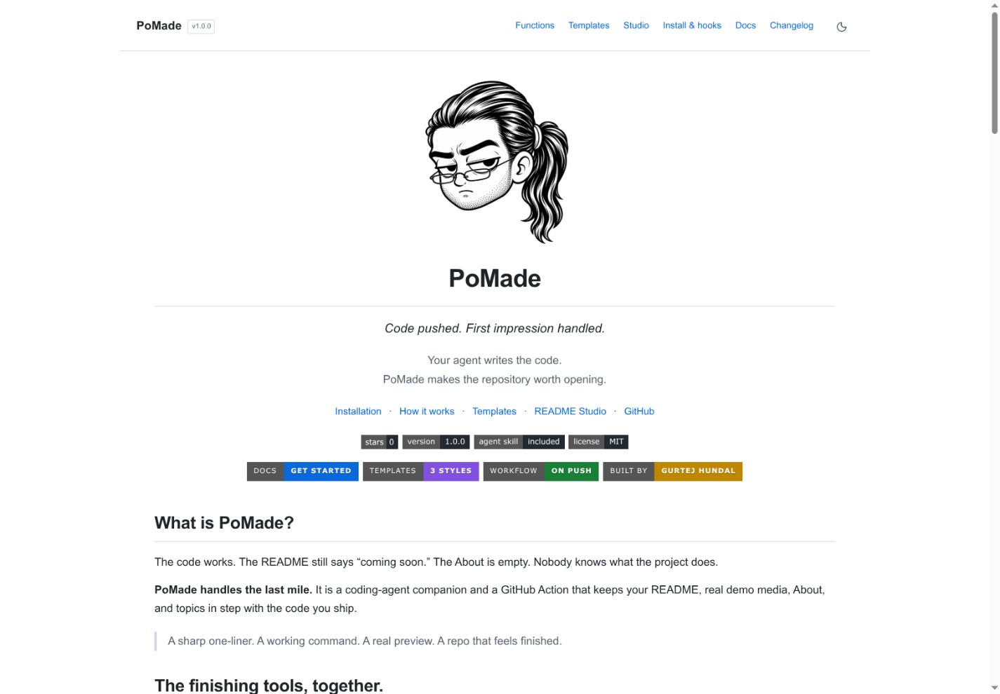
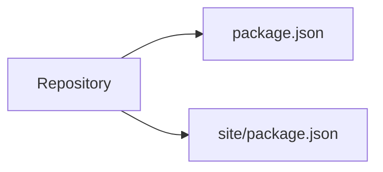

<p align="center"></p>

<h1 align="center">PoMade</h1>

<p align="center"><em>Code pushed. First impression handled.</em></p>

 [](../../LICENSE) [](https://github.com/Gurtejhundal/PoMade/actions)

[Quickstart](#quickstart) · [Features](#features) · [Repository](https://github.com/Gurtejhundal/PoMade)

## Overview

The repository presentation companion for coding agents. Keep your README, real media, GitHub About, and topics in step with the code you ship.

## See it in action

<p align="center"></p>

## Quickstart

```bash
git clone https://github.com/Gurtejhundal/PoMade.git
cd PoMade
npm ci
npm run build
npm link
```

## Features

- **Three README styles** — Simple for a clear first run, Signature for a distinct identity, and Motion for an animated cover and real demo media.
- **Polish after a push** — A GitHub Action maintains marked README sections and cover assets on pushes to main. Text outside managed sections stays yours.
- **The whole front door** — Configure a concise About, homepage, and curated topics. Sync metadata with an administration-scoped token while preserving existing topics.
- **A coding-agent companion** — The bundled skill includes presentation in requested commit and push workflows. A Claude Code plugin manifest is included.
- **Preview before writing** — Review a saved plan with target hashes, then apply that exact plan. Stale targets, escaping paths, and malformed markers are rejected.

## Usage

```bash
# Run inside the repository you want to polish
pomade init --preset signature --approved
pomade diff
pomade apply --approved
```

## Architecture



## Development

Configured test command (its presence does not imply tests pass):

```bash
npm test
```

## License

[MIT](../../LICENSE)
